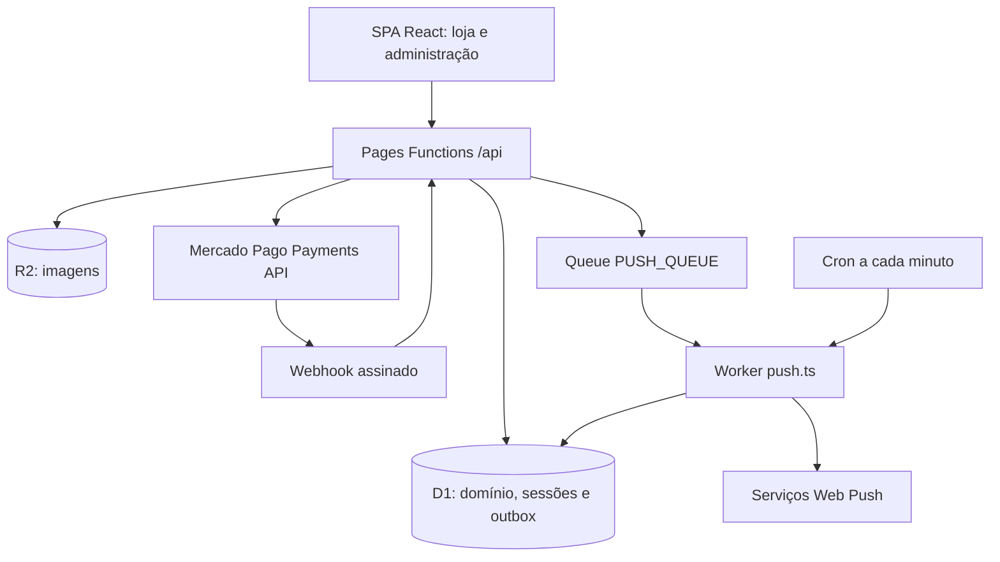

# R&P Doces — Documentação técnica oficial

A R&P Doces reúne uma loja pública de confeitaria e um painel administrativo para catálogo,
pedidos, comandas de balcão, pagamentos, estoque e despesas. O objetivo é permitir a compra por Pix
sem cadastro de cliente e manter os fatos financeiros e a movimentação física rastreáveis na operação.

**Base desta auditoria:** branch `main`, commit
`ca36fec167160e828873543a7dfce96cc06a43e2`, consultado em `origin/main` em 26/10/2026.
As descrições abaixo foram confrontadas com código, migrations, lockfile e workflows desse commit.
O código e a configuração versionada prevalecem sobre textos anteriores. A auditoria local não
comprova o estado dos recursos, secrets ou deployments remotos.

O pacote declara versão **1.0.0**. Isso não comprova publicação de release ou criação de tag;
consulte [CHANGELOG.md](CHANGELOG.md) e o [checklist de release](docs/RELEASE-CHECKLIST.md).

## 1. Funcionalidades e escopo

| Área                | Implementação existente                                                                                                                                 |
| ------------------- | ------------------------------------------------------------------------------------------------------------------------------------------------------- |
| Loja pública        | Home institucional, cardápio por categoria, busca, detalhes de peso/ingredientes/alergênicos, destaques, novidades e promoções com vigência.            |
| Sacola              | Persistência em `localStorage`, ajuste de quantidades ao reconciliar com o catálogo e acesso ao último pedido.                                          |
| Checkout            | Nome, WhatsApp brasileiro e recado; preços calculados no servidor, reserva de produtos e Pix dinâmico Mercado Pago. O pedido usa retirada.              |
| Acompanhamento      | QR Code, copia e cola, contagem regressiva e consultas periódicas; detalhe público por token aleatório, sem login de cliente.                           |
| Administração       | Login, dashboard, produtos/categorias, comandas, despesas itemizadas, configurações da loja, equipe e notificações.                                     |
| Comandas            | Criação manual, pagamentos múltiplos, cobrança/regeneração de Pix, adição, cancelamento e troca de itens, histórico, arquivamento e anulação auditável. |
| Imagens de produtos | Upload autenticado para R2; leitura pública pela API, com validação do nome do objeto.                                                                  |
| Notificações        | Central interna consultada periodicamente; Web Push de pedido pago com outbox D1, Queue e Worker de entrega/recuperação.                                |
| Interface           | Header contextual, temas claro/escuro compartilhados, layout responsivo e PWA administrativa com fallback offline.                                      |

Há funcionalidades parciais e dependências operacionais; veja [limitações](#13-limitações-e-pendências).
Atualizações de pedidos e alertas usam polling, sem canal WebSocket/SSE implementado.
Registrar cartão ou Pix externo no balcão é lançar um recebimento informado pelo operador:
não há integração com adquirente de cartão, TEF ou terminal físico.

## 2. Stack e versões verificadas

As versões exatas abaixo vêm de `package-lock.json` e coincidiram com `npm ls --depth=0`
no ambiente da auditoria. Os intervalos em `package.json` podem ser mais amplos; use `npm ci`.

| Componente          | Versão resolvida      | Responsabilidade                                               |
| ------------------- | --------------------- | -------------------------------------------------------------- |
| React / React DOM   | 18.3.1 / 18.3.1       | SPA renderizada por `createRoot`                               |
| React Router DOM    | 6.30.6                | `BrowserRouter`, rotas declarativas e carregamento sob demanda |
| Motion              | 14.0.0                | Animações da interface                                         |
| TypeScript          | 5.9.3                 | Tipos do frontend, Functions, regras compartilhadas e Worker   |
| Vite / plugin React | 5.4.21 / 4.7.0        | Servidor de UI e build de `dist/`                              |
| Workers Types       | 4.20260702.1          | Tipos de D1, R2, Queues e runtime Cloudflare                   |
| Wrangler            | 3.114.17              | Desenvolvimento Pages, D1 e ferramentas de implantação         |
| `@mmmike/web-push`  | 1.3.0                 | Transporte Web Push com VAPID                                  |
| JSDOM               | 30.1.1                | Testes de componentes e comportamento DOM                      |
| Playwright Test     | 1.63.0                | E2E com Chromium no CI                                         |
| Biome / Prettier    | 2.5.15 / 3.9.9        | Lint e formatação                                              |
| Miniflare / esbuild | 3.20250718.3 / 0.21.5 | Dependências transitivas utilizadas pela bancada de testes     |

O frontend usa CSS próprio, variáveis semânticas, SVGs e ícones definidos no projeto.
Não há Tailwind CSS, Lucide React ou biblioteca de componentes declarados nas dependências.
O backend utiliza Cloudflare Pages Functions, D1 (SQLite), R2 e Queues, além de um Worker separado.
O gateway integrado é a Payments API do Mercado Pago (`/v1/payments` e seus refunds).

### Requisitos

- **Node.js 24, a partir de 24.15.0**, para acompanhar o CI e satisfazer o requisito do JSDOM
  travado no lockfile. Node 18/20 não atende à stack de testes atual. O pacote raiz não define `engines`.
- npm com suporte ao lockfile v3. A auditoria usou Node **24.22.1** e npm **11.19.1**;
  o CI seleciona Node 24 e não fixa uma versão independente de npm.
- Git; para operações remotas, conta Cloudflare e permissões dos recursos correspondentes.
- No Windows, a suíte de staging também exige Git for Windows com Bash no layout esperado a partir
  de `git --exec-path`. Uma distribuição reduzida de Git sem `bin/bash.exe` causa `ENOENT` nos
  subcasos que executam o gate shell de staging; isso ocorreu no ambiente desta auditoria.
- Chromium do Playwright para E2E, ou `CHROME_PATH` apontando para um Chrome instalado.

## 3. Arquitetura e pontos de entrada



`index.html` e `src/main.tsx` iniciam a SPA; `src/App.tsx` monta os providers e as árvores de rotas.
Não há SSR. As rotas administrativas são carregadas sob demanda, fora do `PageTransition` público.
`public/_redirects` fornece o fallback de navegação da SPA no Pages.

`functions/_middleware.ts` cria contexto de requisição, logs correlacionados e `X-Request-Id`.
`functions/api/admin/_middleware.ts` aplica `Cache-Control: no-store`; **a autenticação é feita nos
handlers por `requireUser`**, e as mutações verificam origem. Não existe
`functions/api/_middleware.ts` fazendo autenticação global.

Os handlers delegam regras a `functions/lib/`. D1 guarda fatos e projeções; o navegador não determina
preços, aprovação financeira, expiração autoritativa ou baixa de estoque. `db.batch()` delimita
transações locais. Chamadas a Mercado Pago, R2 e Queue ficam fora da transação D1 e exigem
idempotência, compensação ou recuperação, conforme o fluxo.

### Estrutura de diretórios

```text
rp-doces-admin/
├── src/
│   ├── main.tsx, App.tsx, global.css
│   ├── api/                  # Mapeamento de catálogo e configuração HTTP
│   ├── pages/                # Loja e telas de checkout/acompanhamento
│   ├── components/           # Header, frame, ondas, sacola e componentes visuais
│   ├── context/              # CartContext e StoreThemeContext
│   ├── hooks/, lib/, types/  # Polling, operação do checkout e contratos da UI
│   └── admin/
│       ├── auth/, theme/, components/, pwa/, notificacoes/
│       ├── Dashboard/, Produtos/, Pedidos/
│       └── Despesas/, Loja/, Administradores/, Login/
├── functions/
│   ├── _middleware.ts        # Correlação de requisições
│   ├── api/                  # Rotas públicas, auth, webhook e admin
│   ├── lib/                  # Domínio, persistência, segurança e integrações
│   └── types/                # Declarações auxiliares do runtime
├── shared/                   # Promoção, WhatsApp, detalhes, despesas e anulação
├── workers/                  # push.ts e bootstrap inerte
├── migrations/               # 0001 a 0037, em ordem
├── seed/products.sql         # Catálogo local; não cria administrador
├── public/                   # Assets, headers, redirects, manifesto e sw-admin.js
├── tests/                    # *.test.mjs, helpers, fixtures e e2e/
├── scripts/                  # Runners, migrations, staging, backup e smoke
├── docs/                     # Runbooks e documentação complementar
├── .github/workflows/        # CI/deploy Pages e auditoria de dependências
├── wrangler.toml             # Pages de produção: DB, PRODUCT_IMAGES, PUSH_QUEUE
├── wrangler.staging.toml     # Pages de staging isolado
├── wrangler.push*.toml       # Worker ativo/bootstrap, produção e staging
├── package.json, package-lock.json
└── vite.config.ts, tsconfig*.json, playwright.config.ts, biome.json
```

### Módulos principais

| Módulo                                                                                         | Responsabilidade                                                                                                |
| ---------------------------------------------------------------------------------------------- | --------------------------------------------------------------------------------------------------------------- |
| `src/context/CartContext.tsx` e `cartReconciliation.ts`                                        | Sacola persistente e ajuste ao catálogo disponível.                                                             |
| `src/context/StoreThemeContext.tsx`                                                            | Sincronização de `data-theme`, `data-admin-theme` e preferências persistidas. `AdminThemeContext` delega a ele. |
| `src/components/Header.tsx`, `StorefrontFrame.tsx`, `StorefrontWave.tsx`                       | Navegação contextual, container de rolagem, onda e máscara de gradiente compartilhados.                         |
| `src/admin/Pedidos/PedidoDetalhe/`                                                             | Componentes e hooks de detalhes, itens, pagamentos, Pix e intenções de pagamento manual.                        |
| `functions/lib/comandaLedger.ts` → `ledger/`                                                   | Fachada de pagamentos, estornos, alocações waterfall, projeções e compatibilidade legada.                       |
| `functions/lib/comandaPix.ts` → `pix/`                                                         | Fachada de emissão, replay e regeneração de cobrança administrativa.                                            |
| `functions/lib/paymentSync.ts` → `paymentSync/`                                                | Cliente verificado, resolução de webhook, transições, sweeps e recuperação de envio inconclusivo.               |
| `functions/lib/adminPedidos/`                                                                  | Validação, criação, replay, listagem e manutenção de comandas manuais.                                          |
| `functions/lib/operacoes.ts`, `operacaoIdentity.ts`                                            | Identidade canônica, claim e fases das operações idempotentes.                                                  |
| `functions/lib/stock.ts`, `pedidoReconcile.ts`, `pedidoFinanceiroSql.ts`                       | Estado físico por item, convergência financeira/física e projeções SQL.                                         |
| `functions/lib/itemCancellation*.ts`, `itemExchange*.ts`, `financialCoverage.ts`               | Cancelamentos, trocas e cobertura financeira pela linhagem de itens.                                            |
| `functions/lib/mpPost.ts`, `mpSearch.ts`, `mpRefund.ts`, `mpRefundIntent.ts`                   | Criação/busca de Pix e intenção persistente de estorno remoto.                                                  |
| `functions/lib/pedidoAnulacao.ts`, `pedidoValido.ts`                                           | Anulação auditável, bloqueios e filtro de pedidos válidos.                                                      |
| `functions/lib/despesas*.ts`, `dashboardAnalytics.ts`, `resultadoFinanceiro.ts`, `storeDay.ts` | Despesas, indicadores, resultado estimado e recortes de data da loja.                                           |
| `functions/lib/pushOutbox.ts`, `pushNotifier.ts`, `pushTransport.ts`                           | Intenção/outbox, claims, destinatários, retry e transporte de push.                                             |
| `workers/push.ts`                                                                              | Consumidor Queue e recuperação agendada; não é uma rota Pages.                                                  |

As fachadas mantêm os contratos dos subsistemas; preserve essas fronteiras ao evoluir consumidores.
O ledger modela recebimentos, alocações e reembolsos: não há plano de contas com lançamentos
de débito/crédito que caracterize uma contabilidade completa de partidas dobradas.

## 4. Preparação e desenvolvimento local

```sh
git clone https://github.com/vimanoelkkj/rp-doces-admin.git
cd rp-doces-admin
git switch main
npm ci
npm run db:migrate:local
# Opcional, em banco local de desenvolvimento:
npm run db:seed:local
npm run build
npm run pages:dev
```

O Pages local serve `dist/` e Functions normalmente em `http://127.0.0.1:8788`.
`--local` nos scripts de banco utiliza o estado do Wrangler em `.wrangler/`; não aplica migrations
nem seed no D1 remoto. O seed não deve ser usado para repopular um ambiente com dados reais.
Após alterar a UI, gere novamente `dist/` para o Pages local.

`npm run dev` inicia **somente Vite**, normalmente na porta 5173. `vite.config.ts` não configura
proxy de `/api`; portanto Vite isolado não fornece D1, autenticação ou checkout.
`npm run preview` também serve somente os arquivos compilados. Os E2E usam Vite e fixtures/mocks
conforme cada teste, sem comprovar a integração remota de pagamento.

Vite compila a UI, não empacota a API em `dist/`. Wrangler/Pages processa o diretório `functions/`
ao executar/publicar Pages; `workers/push.ts` tem configuração e implantação próprias.

No PowerShell com restrição a scripts `.ps1`, use `npm.cmd` e `npx.cmd` no lugar de `npm` e `npx`.
Não é necessário alterar a política de execução da máquina.

### Bindings e variáveis

Não existe arquivo de exemplo de ambiente versionado. Crie `.dev.vars` na raiz para os valores
locais; ele está no `.gitignore`. Nunca copie credenciais de produção para fixtures ou frontend.

```dotenv
MP_ACCESS_TOKEN="<token-de-teste-do-ambiente>"
MP_WEBHOOK_SECRET="<segredo-de-assinatura-do-ambiente>"
VAPID_PUBLIC_KEY="<chave-publica-vapid>"
VAPID_PRIVATE_KEY="<chave-privada-vapid>"
VAPID_SUBJECT="mailto:<contato-do-ambiente>"
```

| Nome                                                     | Uso e escopo                                                                                                                                                                               |
| -------------------------------------------------------- | ------------------------------------------------------------------------------------------------------------------------------------------------------------------------------------------ |
| `DB`                                                     | Binding D1 obrigatório para a API e para o Worker de push.                                                                                                                                 |
| `PRODUCT_IMAGES`                                         | Binding R2 para upload e leitura de imagens de produtos no Pages.                                                                                                                          |
| `PUSH_QUEUE`                                             | Binding produtor no Pages; o consumidor é configurado separadamente no Worker.                                                                                                             |
| `MP_ACCESS_TOKEN`                                        | Secret backend para criar, consultar, cancelar e estornar Pix.                                                                                                                             |
| `MP_WEBHOOK_SECRET`                                      | Secret backend da assinatura; sem ele o webhook responde 503.                                                                                                                              |
| `VAPID_PUBLIC_KEY`, `VAPID_PRIVATE_KEY`, `VAPID_SUBJECT` | Configuração de push no Pages e no Worker. Configure ambos: secrets de um não são herdados pelo outro. O código tem fallback de subject, mas os runbooks exigem os três valores validados. |
| `VITE_APP_ENV`                                           | Variável pública de build; `staging` habilita o indicador visual do ambiente. Não colocar secrets em variáveis `VITE_*`.                                                                   |
| `BASE_URL`, `CHROME_PATH`, `CI`                          | Configuração do Playwright; URL padrão `http://127.0.0.1:5173`, Chrome opcional e modo CI.                                                                                                 |
| `SMOKE_BASE_URL` / `PRODUCTION_URL`                      | URL do script de smoke; sem configuração, ele consulta `https://rpdoces.com.br`.                                                                                                           |
| `CLOUDFLARE_ACCOUNT_ID`, `CLOUDFLARE_API_TOKEN`          | Operações remotas do Wrangler/CI; não são credenciais da aplicação cliente.                                                                                                                |
| `CLOUDFLARE_D1_READ_TOKEN`                               | Token separado, somente D1 Read, usado pelo migration guard remoto.                                                                                                                        |
| `WRANGLER_TOML`, `D1_DATABASE_ID`                        | Seleção de configuração/banco pelo migration guard; padrão vem de `wrangler.toml`.                                                                                                         |

Sem credencial Mercado Pago, o catálogo pode ser desenvolvido localmente, mas o Pix não é validado
ponta a ponta. D1/R2 locais não isolam chamadas externas feitas com um token real. O produtor Queue
do Pages local não equivale ao consumidor e cron remotos; use os testes de outbox ou staging isolado
para validar esse conjunto. Não presuma que iniciar `pages:dev` inicia também `workers/push.ts`.

### Primeiro administrador local

As migrations criam `usuarios_admin`, mas não cadastram usuário inicial. O seed contém somente
produtos; não há endpoint público de cadastro nem script de bootstrap administrativo.
Em um banco local novo, gere o hash com `hashPassword` de `functions/lib/auth.ts` e insira o primeiro
usuário ativo com papel `OWNER`. Não use senha em texto puro na coluna `senha_hash`.

Este exemplo PowerShell usa a implementação real para gerar o hash; a senha é lida sem eco e
passada por stdin, fora dos argumentos do processo:

```powershell
$senhaLocal = Read-Host 'Senha local (mínimo 8 caracteres, letra e número)' -AsSecureString
[System.Net.NetworkCredential]::new('', $senhaLocal).Password | node --input-type=module -e "import { build } from 'esbuild'; const b = await build({ entryPoints: ['functions/lib/auth.ts'], bundle: true, platform: 'node', format: 'esm', write: false }); const m = await import('data:text/javascript;base64,' + Buffer.from(b.outputFiles[0].text).toString('base64')); let s = ''; for await (const c of process.stdin) s += c; s = s.replace(/\r?\n$/, ''); const e = m.validatePassword(s); if (e) throw new Error(e); console.log(await m.hashPassword(s));"
Remove-Variable senhaLocal
```

Em arquivo SQL privado fora do repositório, substitua os marcadores por identidade local e hash
gerado (formato `pbkdf2_sha256$100000$<salt-hex>$<hash-hex>`):

```sql
INSERT INTO usuarios_admin (nome, username, email, senha_hash, papel, ativo)
VALUES ('<nome-local>', '<usuario-local>', '<email-local>', '<hash-gerado>', 'OWNER', 1);
```

```powershell
# Caminho do arquivo SQL privado preparado acima; exclusivamente D1 local:
npx.cmd wrangler d1 execute rp-doces-db --local --file "$env:TEMP/rp-doces-admin-local.sql"
```

Remova o arquivo privado após o uso e acesse `/admin/login`. A criação dos próximos usuários é
feita pelo OWNER autenticado. O provisionamento inicial remoto exige procedimento operacional
controlado; não é automatizado pelo repositório.

## 5. Comandos e validação de desenvolvimento

| Comando                                                       | Efeito                                                                                  |
| ------------------------------------------------------------- | --------------------------------------------------------------------------------------- |
| `npm ci`                                                      | Instala as versões travadas, sem atualizar o lockfile.                                  |
| `npm run dev`                                                 | Servidor Vite da UI.                                                                    |
| `npm run typecheck:frontend`                                  | `tsc --noEmit`, usando `tsconfig.json`.                                                 |
| `npm run typecheck:functions`                                 | `tsc --noEmit -p tsconfig.functions.json`; inclui Functions, `shared/` e `workers/`.    |
| `npm run typecheck`                                           | Executa as duas checagens de tipos.                                                     |
| `npm run build`                                               | `npm run typecheck && vite build`; gera `dist/`.                                        |
| `npm run lint`                                                | `biome check .`; não corrige arquivos automaticamente.                                  |
| `npm test`                                                    | Descobre `tests/*.test.mjs` e executa arquivos sequencialmente; para na primeira falha. |
| `npm test -- --keep-going`                                    | Executa todos os arquivos e agrega falhas.                                              |
| `npm test -- --verify-shards=10`                              | Confere cobertura das dez fatias, sem executar os casos.                                |
| `npm test -- --shard=1/10 --keep-going`                       | Executa uma fatia determinística, como no CI.                                           |
| `npm run test:cached`                                         | Runner com cache por dependências; não substitui a execução integral antes de release.  |
| `npx playwright install chromium`                             | Instala o navegador necessário aos E2E locais.                                          |
| `npm run test:e2e`                                            | E2E de `tests/e2e/`; o config inicia/reutiliza Vite.                                    |
| `npm run preview`                                             | Preview estático de `dist/`.                                                            |
| `npm run pages:dev`                                           | Emulador Pages, Functions e bindings locais sobre `dist/`.                              |
| `npm run db:migrate:local`                                    | Aplica migrations pendentes em `rp-doces-db --local`.                                   |
| `npm run db:seed:local`                                       | Executa `seed/products.sql` no D1 local.                                                |
| `npm run db:migrations:check`                                 | Consulta o D1 remoto via API REST com token Read; não aplica migrations.                |
| `node scripts/check-staging-config.mjs`                       | Valida referências e isolamento da configuração de staging.                             |
| `node scripts/check-staging-config.mjs --require-provisioned` | Também recusa placeholder de D1 ainda não provisionado.                                 |
| `npm run smoke:prod`                                          | Smoke HTTP de leitura; aponta para produção por padrão. Não o trate como teste local.   |

O runner Node usa bancadas Miniflare/D1 descartáveis, fixtures e bundles esbuild para testar
concorrência, rollback, idempotência, pagamentos, estoque, segurança, UI e push. Em 26/10/2026,
o runner descobriu **111 arquivos** `*.test.mjs`; o número de casos evolui com o código.
Playwright cobre navegação, temas, foco, layout e comportamento mobile separadamente.

Prettier é configurado em `.prettierrc`; Biome em `biome.json`, com formatter desativado.
Não existe script npm de formatação. O lint está em adoção incremental e é **não bloqueante no CI**.

## 6. Rotas e contratos HTTP

Os caminhos seguem a estrutura de arquivos de Pages Functions. IDs dinâmicos são representados
por `:id` nas tabelas. A API retorna JSON, geralmente `{ error: mensagem, code?: codigo }` em falhas;
o webhook usa `{ erro: mensagem }`. Não há envelope uniforme em todas as rotas.

### Rotas públicas e autenticação

| Método e caminho                                                    | Contrato e efeitos                                                                                                                                                          |
| ------------------------------------------------------------------- | --------------------------------------------------------------------------------------------------------------------------------------------------------------------------- |
| `GET /api/produtos`                                                 | `{ produtos: [...] }`, itens `disponivel = 1`, categoria, preços, promoção, estoque total/reservado e detalhes. A UI calcula disponibilidade livre no mapper. Leitura pura. |
| `GET /api/config`                                                   | `{ config: ... }` com dias, horários, local/endereço, Maps, disponibilidade informativa de entrega e WhatsApp.                                                              |
| `PUT /api/config`                                                   | Atualiza configuração; exige sessão e mesma origem, apesar do caminho fora de `/api/admin`.                                                                                 |
| `POST /api/checkout`                                                | Cria a operação de compra/Pix, exige mesma origem e `operationKey`.                                                                                                         |
| `GET /api/pedido?token=...`                                         | Detalhes e itens não cancelados de um pedido válido. Token autoriza a consulta; `no-store`.                                                                                 |
| `GET /api/pedido-status?token=...`                                  | Consulta o estado persistido; não sincroniza com Mercado Pago.                                                                                                              |
| `POST /api/pedido-status?token=...`                                 | Recuperação explícita: consulta MP com throttle por tentativa, reconcilia e trata expiração; exige mesma origem.                                                            |
| `POST /api/reservas/reconciliar`                                    | Sem payload: liberação local limitada de reservas vencidas do site; mesma origem e rate limit. Não consulta MP.                                                             |
| `GET /api/images/:key`                                              | Streaming público R2 de chave permitida; cache de um ano e `immutable`; 404 para chave/objeto inválido.                                                                     |
| `POST /api/auth/login`, `POST /api/auth/logout`, `GET /api/auth/me` | Sessão administrativa; mutações exigem mesma origem. Login recebe `username` e `senha`.                                                                                     |
| `POST /api/webhooks/mercadopago`                                    | HMAC obrigatório, reconsulta MP e aplica transição verificada.                                                                                                              |

Exemplo de corpo do checkout (dados fictícios):

```json
{
  "items": [{ "id": 1, "quantity": 2 }],
  "cliente": { "nome": "Cliente de teste", "whatsapp": "(11) 99999-9999" },
  "recado": "Mensagem para embalagem",
  "operationKey": "<uuid-da-intencao>"
}
```

O sucesso retorna `pedidoId`, `tokenPublico`, `paymentId`, `status` remoto, `qrCode`,
`qrCodeBase64`, `ticketUrl`, `expiresAt` e `totalCentavos`. QR/URL podem ser nulos.
Limites do checkout: até 50 entradas, quantidade inteira de 1 a 50 por entrada, nome até 200
caracteres, WhatsApp validado e recado limitado a 200 caracteres. Valores/preços não vêm do cliente.

### API administrativa

Todas as famílias abaixo verificam sessão nos handlers; mutações verificam mesma origem.
As regras OWNER/ADMIN são aplicadas adicionalmente onde cabíveis.
Na tabela, os caminhos abreviados representam sufixos da família indicada, mantendo `/api/admin`.

| Família                                                                                          | Métodos e responsabilidade                                                                                                                               |
| ------------------------------------------------------------------------------------------------ | -------------------------------------------------------------------------------------------------------------------------------------------------------- |
| `/api/admin/dashboard`                                                                           | GET de indicadores e séries do período.                                                                                                                  |
| `/api/admin/produtos`, `/produtos/:id`, `/produtos/:id/imagem`                                   | GET/POST de catálogo, PUT de produto, POST multipart (`image`)/DELETE de foto.                                                                           |
| `/api/admin/categorias`                                                                          | GET/POST de categorias.                                                                                                                                  |
| `/api/admin/pedidos`, `/pedidos/:id`                                                             | GET listagem/detalhe, POST de pedido manual, PATCH de status, nome e arquivamento conforme contrato.                                                     |
| `/api/admin/pedidos/reconciliar`, `/pedidos/:id/reconciliar`                                     | POST explícito de manutenção/convergência; GETs de pedidos permanecem leitura.                                                                           |
| `/api/admin/pedidos/:id/pagamentos`, `/pix`, `/reembolsos`                                       | POST de pagamento manual, criação/regeneração Pix e registro de estorno manual.                                                                          |
| `/api/admin/pedidos/:id/itens`                                                                   | POST adiciona item; PUT de substituição integral permanece bloqueado com 409.                                                                            |
| `/api/admin/pedidos/:id/itens/:itemId/cancelamento-preview`, `/troca-preview`                    | GET da simulação financeira/física antes da operação.                                                                                                    |
| `/api/admin/pedidos/:id/itens/:itemId/cancelamentos`, `/trocas`                                  | GET do estado e POST de execução auditável.                                                                                                              |
| `/api/admin/pedidos/:id/cancelamentos/:cancelamentoId/reembolsos`, `/trocas/:trocaId/reembolsos` | POST de estorno vinculado à linhagem do item.                                                                                                            |
| `/api/admin/pedidos/:id/anulacao`, `/anulacao/estorno`, `/historico`                             | POST anula; GET/POST consulta/processa estorno preparatório; GET histórico.                                                                              |
| `/api/admin/despesas`, `/despesas/:id`, `/despesas/:id/cancelar`                                 | GET/POST, GET/PUT/PATCH e POST de cancelamento lógico.                                                                                                   |
| `/api/admin/administradores`, `/administradores/:id`                                             | GET/POST e PUT. OWNER gerencia equipe; ADMIN tem acesso limitado à própria conta. A troca de senha está no PUT, não em `/senha`.                         |
| `/api/admin/notificacoes`                                                                        | GET da central e POST de leitura.                                                                                                                        |
| `/api/admin/push/vapid-key`, `/subscribe`, `/unsubscribe`, `/test`, `/retry`                     | GET da chave pública e POSTs de inscrição, remoção, teste e recuperação.                                                                                 |
| `/api/admin/diagnosticos/*`                                                                      | `pix`, `pix-reembolso`, `pedido-teste` (POST) e `pix-status` (GET), com restrições OWNER. Podem produzir efeitos reais quando usados com recursos reais. |

O contrato completo de cada payload está nos tipos e validações do handler correspondente.
Erros relevantes incluem 400 (entrada), 401 (sessão/assinatura), 403 (origem/permissão), 404,
409 (conflito de domínio/idempotência), 429 (limite), 500 e 502/503 (integração/configuração).
Replays não eliminam a possibilidade de falhas transitórias: o cliente deve preservar a intenção
e sua chave, consultar o estado e apresentar a mensagem/código devolvidos.

## 7. Banco D1 e migrations

### Modelo de domínio

| Grupo               | Entidades e papel                                                                                                                                                              |
| ------------------- | ------------------------------------------------------------------------------------------------------------------------------------------------------------------------------ |
| Catálogo            | `produtos`, `categorias`: preços, promoções, detalhes, ordenação e contadores de estoque.                                                                                      |
| Pedido              | `pedidos`, `pedido_itens`: identificação pública, cliente, status, snapshots de item/preço e estado físico por item. Colunas globais/legadas são mantidas por compatibilidade. |
| Recebimentos        | `pedido_pagamentos`, `pedido_pagamento_alocacoes`: tentativas/recebimentos e distribuição do valor entre itens.                                                                |
| Devoluções          | `pedido_reembolsos`, `pedido_reembolso_alocacoes`, `pedido_reembolso_pix_mp_intencoes`: fatos de estorno, cobertura e estado da comunicação remota.                            |
| Comanda viva        | `pedido_item_cancelamentos`, `pedido_item_trocas`, `pedido_item_troca_reembolso_alocacoes`: cancelamento/troca e linhagem financeira.                                          |
| Operações/anulações | `pedido_operacoes`, `pedido_anulacoes`: deduplicação, fases, resultado e bloqueio auditável.                                                                                   |
| Administração       | `usuarios_admin`, `admin_sessoes`, `auth_rate_limits`, `checkout_rate_limits`.                                                                                                 |
| Operação            | `configuracoes_loja`, `notificacao_leituras`, `admin_diagnostico_eventos`, `despesas`, `despesa_itens`.                                                                        |
| Push                | `admin_push_subscriptions`, `push_eventos` e marcadores de intenção em `pedido_pagamentos`.                                                                                    |

Dinheiro de domínio é armazenado em centavos inteiros. Quantidades fracionárias das despesas usam
`quantidade_milesimos`; totais de itens/despesas são calculados pelo servidor. Despesas canceladas
não podem ser reativadas e ficam fora do resultado estimado. Não movimentam estoque de produtos.

### Evolução do schema

Existem **37 migrations**, de `0001_products.sql` a `0037_push_paid_intent.sql`.
Os arquivos completos e sua ordem são a referência; os grupos abaixo facilitam a navegação:

| Faixa     | Mudança                                                                                       |
| --------- | --------------------------------------------------------------------------------------------- |
| 0001–0007 | Produtos, pedidos/itens, administração, categorias e alinhamento com modelo histórico.        |
| 0008–0013 | Ledger, reembolsos, índices, operações idempotentes e colunas legadas de compatibilidade.     |
| 0014–0019 | Leituras de notificação, diagnósticos, estoque por item, adição, cancelamento e trocas.       |
| 0020–0024 | Intenções de refund Pix, cobertura por linhagem, anulação e exclusão mútua de estornos.       |
| 0025–0029 | Configuração da loja, despesas, rate limit público, expiração e regeneração ativa.            |
| 0030–0034 | Inscrições/eventos push, guards de capacidade de estorno, último OWNER, detalhes e novidades. |
| 0035      | `0035_push_event_claim_lease.sql`: lease renovável dos eventos push.                          |
| 0036      | `0036_push_event_exclusion.sql`: exclusão de destinatário preservada na recuperação.          |
| 0037      | `0037_push_paid_intent.sql`: intenção durável de push no pagamento e cópia do autor excluído. |

As migrations históricas **não são exclusivamente aditivas**: há reconstruções com
create/copy/drop/rename, inclusive de tabelas com dependentes. Não edite migrations já aplicadas
nem execute partes avulsas para "corrigir" o histórico. Evolua por novo arquivo numerado e teste
a aplicação integral, preservação de dados e integridade de FKs/triggers.

```sh
# Somente banco local:
npm run db:migrate:local
```

O procedimento remoto é manual e separado da publicação: backup verificado, conferência da conta
e banco, aplicação das migrations pendentes com Wrangler e migration guard de leitura antes do
deploy. O comando de produção previsto nos runbooks é
`npx wrangler d1 migrations apply rp-doces-db --remote`; ele **altera o banco real** e não faz parte
do início local nem da auditoria deste README.

O guard `scripts/check-d1-migrations.mjs` compara `d1_migrations`, nomes/ordem/lacunas e marcadores
do schema mais recente. Falha fechada quando não consegue confirmar o estado. Não aplica migrations
e não é um validador universal de todos os dados financeiros.
Veja [migrations](docs/architecture/database-migrations.md),
[backup/restore](docs/BACKUP-RESTORE.md) e [rollback](docs/ROLLBACK.md).

## 8. Pedidos, pagamentos, Pix e estoque

### Preços e promoções

`shared/promocao.ts` concentra a regra usada pelo backend e pela exibição da UI. Os estados reais
são `DESLIGADA`, `SEM_PRECO`, `FUTURA`, `VIGENTE` e `EXPIRADA`. A vigência é resolvida no instante
da leitura, sem cron para ativar/desativar promoções. Datas novas usam ISO com timezone; o parser
também trata timestamps históricos de SQLite como UTC. O checkout recalcula o preço autoritativo
e o congela nos itens do pedido; uma atualização posterior do catálogo não reprecifica esse fato.

### Checkout público

1. O cliente cria uma `operationKey` para a finalização e a preserva nos retries.
2. O handler valida origem, corpo, identidade de replay, rate limit e catálogo/preços vigentes.
   Antes de uma compra nova, tenta liberar reservas locais vencidas, sem bloquear a compra se essa
   manutenção falhar. Horário de atendimento não é um bloqueio de checkout implementado.
3. Um único batch grava pedido, itens, pagamento `PIX_MP/PENDENTE`, alocações, reserva e claim
   `LOCAL_CRIADA`, incluindo o corpo original de criação remota. Isso ocorre **antes** do POST ao MP.
4. O MP recebe `X-Idempotency-Key` determinística (`a1:<operationKey>:mp`), valor em reais,
   `payment_method_id=pix`, expiração de 30 minutos e `external_reference=token_publico`.
   Como o checkout não coleta e-mail, o backend cria e-mail sintético a partir do WhatsApp.
5. Com resposta utilizável, salva identidade/QR/expiração e fases da operação. A reserva nasce
   estimada em 31 minutos e é alinhada ao vencimento remoto mais um minuto de folga.
6. A UI acompanha o estado por polling e POST explícito de recuperação; o contador visual não
   aprova pagamento nem libera estoque sozinho.

Timeout, transporte, HTTP 408/429/5xx ou sucesso ilegível são **ambíguos**: a operação permanece
`ENVIO_INCONCLUSIVO`, sem inventar falha nem criar novo pedido. O checkout pode responder 502 com
`pedidoId` e `tokenPublico` para acompanhamento. Recusa definitiva comprovada marca a tentativa
como falha e tenta liberar a reserva sob os guards de concorrência.

### Reconciliação e protocolos de domínio

- **A1:** chave e identidade da operação; claim/replay transacional e conflito de payload/escopo/ator.
- **B1:** substituição integral de itens bloqueada; alterações usam adição, cancelamento e troca auditáveis.
- **B2:** confirmação vem de GET verificado ao MP; inclusive para um Pix localmente expirado.
- **B3:** reconciliação financeira e baixa física repetíveis para convergir após falha parcial.
- **B4:** liberação de reserva verifica pagamentos pendentes, fatos remotos incertos e regeneração ativa;
  a origem MANUAL não expira sua reserva por relógio.
- **B5:** compatibilidade com schema/colunas históricas de produção, sem usar essas colunas como
  fonte para a composição multi-item atual.

Os nomes históricos não são uniformes entre documentos e testes: `B-1` também identifica a
visibilidade imediata de pedidos MANUAL, `B-2` o registro de estorno manual de Pix e `B-3` a busca
de envio inconclusivo em `/v1/payments/search`. O README anterior também chamava de B5 a separação
de GETs de leitura e POSTs de reconciliação, enquanto `tests/b5-cutover.test.mjs` cobre o cutover de
compatibilidade. Use a responsabilidade e o módulo correspondente para identificar cada regra.

Os sweeps financeiros são limitados e acionados pelos fluxos de reconciliação; não há cron
financeiro autônomo declarado nos configs. O cron de `workers/push.ts` é específico de notificações.
Sem webhook, polling ou manutenção administrativa, não se deve prometer convergência imediata.
GET de pagamento e busca no MP têm prazo de cinco segundos; POST de pagamento/cancelamento e
operações de refund usam vinte segundos, incluindo leitura do corpo. Sweeps de pagamentos e
recuperação inconclusiva selecionam até quatro candidatos; liberação local de reservas, até dez.

### Estoque físico

Disponibilidade livre é `max(0, estoque - estoque_reservado)`.
`produtos` impõe `estoque >= 0` e `0 <= estoque_reservado <= estoque`.
Atualizações em batch fazem uma disputa pela última unidade abortar integralmente quando violam
o CHECK, sem deixar pedido/reserva parcial daquele batch.

A fonte física por item é `pedido_itens.estoque_estado`:
`NAO_APLICAVEL`, `SEM_RESERVA`, `RESERVADO`, `LIBERADO`, `BAIXADO` ou `REPOSTO`.
`pedidos.reserva_status` e os timestamps globais são projeções de compatibilidade.
Na confirmação financeira, `baixarEstoquePedido` converte os itens aplicáveis em baixa física,
diminuindo estoque/reserva atomicamente dentro do batch de estoque.
Cancelamento/expiração libera reserva sob os guards; reposição após baixa é ação distinta e auditada.

Pagamento aprovado depois da liberação pode encontrar estoque insuficiente: o recebimento continua
válido, mas `estoquePendente` sinaliza necessidade de resolução operacional. Não existe transação
distribuída que torne recebimento remoto e disponibilidade física um único commit.

### Ledger, pagamentos presenciais e resultado

Métodos existentes: `PIX_MP`, `PIX_EXTERNO`, `CARTAO`, `DINHEIRO` e `A_COMBINAR`.
O último é provisório; não comprova recebimento. Alocações waterfall distribuem cobertura entre
itens. O backend recalcula projeções a partir dos fatos, inclusive na linhagem de trocas.

O líquido agregado é `max(0, soma(PAGO) - soma(REEMBOLSADO))` e determina
`PENDENTE` (líquido zero), `PARCIAL` (menor que total) ou `PAGO` (cobre total).
A projeção é **persistida** em `pedidos.status_pagamento` por SQL; não é apenas um cálculo de UI.
O pagamento já contabilizado como `PAGO` não vira um estorno por edição dessa linha:
o reembolso é fato adicional. Há suporte explícito a pedidos legados sem ledger.

Reservas de comanda MANUAL não têm expiração automática. A criação pode incluir recebimento
presencial; outros recebimentos são lançados em `/pagamentos`. Substituição de tentativa provisória
é explícita por `substitui_pagamento_id`, sujeita aos guards, não uma garantia de cancelamento
automático de todo Pix existente ao registrar dinheiro/cartão.

Dashboard e despesas calculam **lucro estimado** a partir do faturamento líquido e despesas ativas.
Não equivalem a apuração contábil/fiscal completa nem calculam CMV por ficha técnica.

### Estornos, cancelamentos, trocas e anulação

| Ação                   | Efeito e restrições                                                                                                                                                                                                                       |
| ---------------------- | ----------------------------------------------------------------------------------------------------------------------------------------------------------------------------------------------------------------------------------------- |
| Estorno manual         | Registra devolução informada pelo operador; não transfere dinheiro via MP. O teto considera o pago menos reembolsos confirmados. A rota genérica é bloqueada para comanda MANUAL aberta, que exige vínculo ao item.                       |
| Refund Pix remoto      | Cancelamento/troca/anulação usam intenção persistente e `/v1/payments/:id/refunds`, com chave estável, consulta de recuperação e guards de capacidade/exclusão mútua. Resultado ambíguo permanece recuperável, sem duplicar o fato local. |
| Cancelamento de pedido | Valida saldo e estado, libera reservas elegíveis; não substitui o estorno de valor já recebido.                                                                                                                                           |
| Cancelamento de item   | Usa preview e operação vinculada ao item, preservando cobertura e escolha de tratamento físico.                                                                                                                                           |
| Troca de item          | Mantém origem/destino e ajustes financeiros/físicos rastreáveis; uma troca pendente não é edição destrutiva do item original.                                                                                                             |
| Arquivamento           | Oculta da listagem principal sem apagar histórico; sujeito aos estados permitidos pelo handler.                                                                                                                                           |
| Anulação               | Registro imutável em `pedido_anulacoes`; bloqueia mutações posteriores por guards e triggers. Exige resolver pendências Pix/estorno e permite escolha explícita de devolução ou perda física.                                             |

O status operacional é separado do financeiro: `NOVO`, `PREPARANDO`, `PRONTO`, `ENTREGUE` e
`CANCELADO`; `status_comanda` usa `ABERTA`/`ENCERRADA`. Triggers encerram a comanda ao atingir estado
terminal. Pedido anulado é filtrado das consultas públicas/operacionais conforme `pedidoValidoSql`.
Veja [ledger](docs/architecture/financial-ledger.md) e [Pix/estoque](docs/architecture/pix-and-stock.md).

## 9. Segurança e integridade

- Senhas: PBKDF2-SHA256, salt aleatório de 16 bytes, 100.000 iterações e comparação sem saída
  antecipada dos bytes. Login inexistente/inativo executa verificação dummy para reduzir enumeração
  por tempo; isso não é garantia de latência idêntica de todas as respostas.
- Sessão: token aleatório de 32 bytes; somente SHA-256 do token fica no D1. Cookie
  `rp_admin_session`, `HttpOnly; Secure; SameSite=Strict`, validade de sete dias.
  Criação condicional à conta ativa e hash vigente protege corrida com redefinição de senha.
- Mudança de senha/desativação revoga sessões; alteração da própria senha exige a senha atual.
  OWNER controla a equipe; guards de banco impedem remover/desativar/rebaixar o último OWNER ativo.
- `sameOrigin` compara `Origin`, ou `Referer` quando necessário, com a origem da requisição.
  Uma mutação sem ambos é recusada. Webhook usa assinatura em vez desse mecanismo.
- Login: limite por IP/usuário (cinco falhas) e por IP (vinte), janela/bloqueio de 15 minutos.
  Checkout: seis novas tentativas por IP/minuto; replay é resolvido antes da contagem.
  Reconciliação pública de reservas: doze chamadas por IP/minuto; 429 com `Retry-After`.
- Valores, catálogo, permissão, identidade remota, método Pix, moeda BRL, referência e montante são
  verificados no backend. Aprovação MP divergente não deve virar recebimento válido.
- D1 combina `CHECK`, FKs, índices `UNIQUE`, triggers e updates condicionais/CAS.
  São garantias locais; falhas entre etapas externas e projeções são tratadas por recuperação.
- `public/_headers` define CSP, bloqueio de iframe, `nosniff`, política de referer e outras políticas
  para assets Pages. Não presuma que todos esses headers estáticos são automaticamente aplicados
  a respostas dinâmicas de Functions; confira o handler/middleware correspondente.
- Token público de pedido funciona como credencial de acesso àquela consulta: evite divulgá-lo
  em logs, capturas ou URLs compartilhadas indevidamente. Não há cadastro/autorização por cliente.

### Identidade e idempotência

As escritas críticas de pedido/pagamento/itens usam `operationKey`; isso não se aplica a toda
mutação do projeto (por exemplo, CRUD de catálogo/configuração e marcação de leitura).
`pedido_operacoes` registra chave única, tipo, escopo, ator, fingerprint, fase e resultado.

`fingerprint` é `1:<JSON canônico>`: ordena chaves de objetos recursivamente, omite `undefined` e
preserva ordem de arrays. **Não é hash, HMAC, assinatura ou autenticação.** Chave repetida com
identidade incompatível resulta em 409; identidade compatível permite replay/recuperação conforme
a fase. Payloads iguais com chaves distintas continuam sendo operações distintas.

As identidades derivadas e constraints garantem deduplicação local; a chave determinística enviada
ao MP cobre retries da mesma intenção remota. Não gere outra chave só porque a rede caiu.

### Webhook Mercado Pago

`POST /api/webhooks/mercadopago` exige `MP_WEBHOOK_SECRET` (ausente: 503) e `x-signature`
com `ts` e `v1` (inválida: 401). O manifest assinado é
`id:<data.id>;request-id:<x-request-id>;ts:<ts>;`, com ID em minúsculas; os trechos ID/request-id
só entram se presentes. O ID vem da query `data.id`/`data_id`, ou dos campos suportados no corpo.
O corpo inteiro não entra no HMAC-SHA256. O validador não implementa janela de idade do timestamp;
replays financeiros são contidos pelas regras de identidade/transição.

Após assinatura, processa tipos `payment`/`payments` ou sem tipo; outros são reconhecidos sem efeito.
O status vem de GET ao MP, não do payload. Associação usa ID remoto e referências; ambiguidade
não escolhe arbitrariamente um pagamento. Falha de sincronização pode responder 502.

O checkout não envia `notification_url`: cadastre a URL HTTPS
`https://<dominio-do-ambiente>/api/webhooks/mercadopago` e eventos de pagamentos no provedor,
conferindo token e segredo do mesmo ambiente. A configuração no painel e um teste de compra,
notificação e convergência precisam de validação operacional; não foram executados nesta auditoria.

## 10. R2, interface e PWA

Upload de produto usa multipart no campo `image`, sessão, mesma origem e limite de **5 MiB**.
Aceita JPEG, PNG e WebP, conferindo MIME declarado e assinatura binária.
Chaves são `product-<id>-<uuid>.jpg|png|webp`: não há conversão automática para WebP no backend.
Se a gravação da referência D1 falha, tenta apagar o objeto novo; ao substituir/remover imagem,
tenta limpar o objeto anterior. R2 e D1 não formam uma transação atômica, e falhas de limpeza
best-effort podem deixar objetos órfãos. A leitura da foto é pública, não autenticada.

Header e frame são compartilhados entre loja e admin. O menu mobile possui controle de foco,
fechamento por interação e navegação inferior administrativa com espaço reservado/safe area.
O tema sincroniza atributos e `localStorage`; `index.html` aplica preferência antes da montagem.
View Transitions usa revelação radial no desktop e crossfade no mobile quando suportada,
respeitando movimento reduzido e fallback. Isso descreve implementação, sem prometer desempenho
garantido em toda tela de 90/120 Hz. O login usa a apresentação própria em `src/admin/Login/`;
não existe `AdminWave.tsx` no estado auditado.

O service worker `public/sw-admin.js` não intercepta `/api/*`, não enfileira mutações offline e
não fornece um PDV offline. Em falha de navegação, oferece a página estática de indisponibilidade.
Ele também recebe push e abre/foca a comanda correspondente. HTTPS/permissão e suporte do navegador
são necessários para Web Push; instalação PWA sozinha não garante entrega.

## 11. Push durável e implantação separada do Worker

Na transição Pix notificável ou na criação manual já paga, a intenção de push é gravada junto
ao fato financeiro (`push_pedido_pago`, `push_exclude_usuario_id`, migration 0037).
Depois, o fluxo tenta registrar `push_eventos` e publicar apenas
`{ pedidoId, evento: "PEDIDO_PAGO" }` em `PUSH_QUEUE`, sem aguardar transporte Web Push.
Falha no envio à Queue ou na criação inicial da outbox pode ser recuperada a partir da intenção.

D1 é a autoridade da entrega. O consumidor adquire claim com lease renovável de 120 segundos e
token de fencing; eventos enviados e claims ativos não são reenviados por mensagem duplicada.
A exclusão do autor de pedido manual é persistida e preservada pela recuperação (migration 0036).
O cron de um minuto reconstrói até cinco eventos ausentes e processa até cinco eventos elegíveis;
falhas respeitam backoff de 30 segundos e teto de três tentativas no D1.
Queue tem até três retries próprios para falhas de infraestrutura, sem substituir a política D1.

A entrega é **at-least-once**, podendo duplicar se o serviço remoto aceitar e o processo cair antes
da confirmação local. Não promete entrega exatamente uma vez nem push para todo evento da central.
Marcadores antigos não são preenchidos apenas por encontrar um pedido agregado `PAGO`.

`wrangler.push.toml` define `workers/push.ts`, consumidor com batch de uma mensagem, timeout de
um segundo, cron `* * * * *`, binding DB e `workers_dev = false`.
O **CI publica somente Pages**. Worker, Queue e secrets precisam ser provisionados/atualizados
separadamente. O bootstrap inerte em `workers/push-bootstrap.ts` existe para cadastrar os secrets
antes de ativar consumidor e cron.

Na primeira implantação, a ordem do runbook é: migrations incluindo 0036/0037 → Queue → Worker
bootstrap → upload conjunto e validação dos três secrets VAPID → Worker ativo com `--keep-vars`
→ conferir DB/consumer/cron → liberar Pages com produtor. Não execute `secret put` sequencial no
consumidor ativo como substituto desse procedimento. O Wrangler travado usa `secret bulk`;
não há suporte à opção nova `deploy --secrets-file` nesse procedimento.
Detalhes e comandos em [push outbox](docs/architecture/push-outbox.md).

## 12. Build, CI e implantação

`wrangler.toml` define Pages `rp-doces`, saída `dist`, `compatibility_date = "2024-09-23"`,
flag `nodejs_als`, D1 `rp-doces-db`, R2 `rp-doces-images` e Queue `rp-doces-push`.
Os IDs ficam na configuração; secrets são cadastrados fora do Git.

### Fluxo de produção versionado

`.github/workflows/ci.yml` roda em PR, push de `main`/`staging`, agendamento diário às 03h de Brasília
e disparo manual. Usa Ubuntu 24.04 e Node 24. O check agregado `CI` exige sucesso de tipos/build,
dez fatias dos testes Node e E2E Playwright. Lint não bloqueia.

O job `deploy` publica Pages somente em **push na `main`**, após `CI` verde e com
`DEPLOY_ENABLED == 'true'`. Usa environment `production`, secrets `CLOUDFLARE_ACCOUNT_ID`,
`CLOUDFLARE_API_TOKEN` e token separado `CLOUDFLARE_D1_READ_TOKEN` no guard.
Verifica se o SHA ainda é HEAD remoto antes de prosseguir e imediatamente antes da publicação,
valida migrations somente por leitura, compila e executa `wrangler pages deploy dist` com projeto,
branch e SHA explícitos. Confirma o deployment pela API Cloudflare e faz smoke de leitura.
O sucesso de `CI` isoladamente não comprova sucesso do job de deploy.

Migrations, criação de recursos e deploy do Worker não são executados automaticamente por esse job.
Configure Direct Upload e evite uma integração Git de Pages que publique por fora desses gates,
conforme [produção](docs/PRODUCTION-CHECKLIST.md) e [release](docs/RELEASE-CHECKLIST.md).

O workflow separado `dependency-audit.yml` relata vulnerabilidades do lockfile e bloqueia
high/critical nas dependências de produção. A aceitação de risco em
[dependency-risk-acceptance.md](docs/architecture/dependency-risk-acceptance.md) é um registro
datado, não uma auditoria atualizada automaticamente nem aceitação de achados futuros.

### Staging

Há projeto Pages, D1, R2, Queue e Worker dedicados, todos com sufixo `-staging`.
A branch de produção do **projeto de staging** é `staging`; o slot chamado `production` pela API
Cloudflare nesse projeto não é o projeto real de produção.

Os configs Pages/Worker de staging ainda contêm `STAGING_D1_ID_REPLACE_AFTER_CREATE`.
O validador com `--require-provisioned` deve falhar até o provisionamento/substituição corretos.
O código versionado não comprova que os recursos já existam remotamente.

O job usa environment `staging`, `STAGING_DEPLOY_ENABLED`, `STAGING_URL` e os três secrets
`STAGING_CLOUDFLARE_ACCOUNT_ID`, `STAGING_CLOUDFLARE_API_TOKEN` e
`STAGING_CLOUDFLARE_D1_READ_TOKEN`, sem fallback para secrets de produção.
O build define `VITE_APP_ENV=staging`. Como Pages no Wrangler 3 rejeita `--config`, o job copia o
config de staging para `wrangler.toml` **no checkout isolado do CI**, antes de publicar.
Não faça essa substituição em um checkout de trabalho com alterações preexistentes.
Veja a sequência completa em [STAGING.md](docs/STAGING.md).

### Backup, restore e rollback

`scripts/d1-backup.mjs` oferece `backup`, `verify`, `restore` e `normalize`, exclusivamente locais.
Recusa modos remotos e remove variáveis de credenciais Cloudflare dos subprocessos.
`verify` restaura em D1 local descartável e confere histórico, schema, sequências, FKs e constraints.
O dump pode conter dados pessoais, hashes e sessões: mantenha-o fora do Git e protegido.

Export/restore de produção e formato do dump remoto não foram comprovados por esta auditoria.
Rollback de código não desfaz pagamentos externos nem é uma reversão automática do schema.
Preserve dados e reconcilie fatos financeiros depois de recuperação; siga
[BACKUP-RESTORE.md](docs/BACKUP-RESTORE.md) e [ROLLBACK.md](docs/ROLLBACK.md).

## 13. Limitações e pendências

| Item                         | Situação no commit auditado                                                                                                                                                           |
| ---------------------------- | ------------------------------------------------------------------------------------------------------------------------------------------------------------------------------------- |
| Entrega e taxa de frete      | Checkout não coleta endereço nem calcula frete; usa retirada. Configuração de disponibilidade de entrega é informativa. Não há chave Pix da loja editável nesse contrato.             |
| Horário de funcionamento     | Exibido/configurável; não impede automaticamente novos checkouts fora do horário.                                                                                                     |
| Imagens da Home no admin     | `ImagensPaginaInicialPanel.tsx` mantém estado local, botão Escolher sem ação e referências antigas a JPG. Não salva imagens da Home; assets reais estão em `public/images/`.          |
| Excedente financeiro         | Pagamentos excedentes podem ser preservados no ledger; não há carteira/crédito de loja dedicada.                                                                                      |
| Edição integral de itens     | PUT retorna 409; usar os fluxos implementados de adição, cancelamento e troca.                                                                                                        |
| Aprovação tardia sem estoque | Pode haver pedido pago com `estoquePendente`; exige tratamento operacional, não aprovação/baixa inventada na UI.                                                                      |
| Estoque de insumos/CMV       | Despesas não implementam ficha técnica, estoque de ingredientes ou baixa automática por receita. Lucro é estimado.                                                                    |
| Offline                      | PWA oferece fallback, não operação transacional offline.                                                                                                                              |
| Tempo de convergência        | Reconciliação financeira depende de gatilhos HTTP/webhook; cron existente é de push.                                                                                                  |
| Push                         | Depende de Worker/secrets/Queue fora do deploy Pages; há possibilidade de duplicidade e teto de tentativas. Lotes de recuperação de cinco podem exigir ajuste para backlog maior.     |
| Staging                      | Configuração preparada com placeholder D1; provisionamento remoto não demonstrado.                                                                                                    |
| Bootstrap de equipe          | Primeiro OWNER exige inserção controlada; não existe assistente/script de cadastro inicial.                                                                                           |
| Dependências/lint            | React Router permanece em v6; há triagem de risco datada. Lint tem baseline e não bloqueia CI. Não foi feito novo `npm audit` de rede nesta auditoria.                                |
| Documentos complementares    | `docs/architecture/overview.md` ainda cita Tailwind/Lucide sem correspondência nas dependências. Use este README e o código para resolver essa divergência; o arquivo foi preservado. |
| Evidência operacional        | Não foram consultados secrets, recursos Cloudflare, painel MP, status de release/tag ou deploys remotos. Testes locais não comprovam produção.                                        |

Outra divergência a verificar no ambiente publicado: `index.html` contém script inline de tema,
mas a CSP estática permite `script-src 'self'` sem nonce/hash para ele. Essa combinação pode bloquear
a aplicação antecipada do tema no Pages. Os arquivos foram preservados nesta auditoria documental.

## 14. Referências e manutenção

- [Visão arquitetural complementar](docs/architecture/overview.md) — contém a divergência de stack indicada acima.
- [Ledger financeiro](docs/architecture/financial-ledger.md).
- [Pix e estoque](docs/architecture/pix-and-stock.md).
- [Migrations D1](docs/architecture/database-migrations.md).
- [Outbox e implantação do push](docs/architecture/push-outbox.md).
- [Estratégia de testes](docs/architecture/testing-strategy.md).
- [Aceitação datada de risco de dependências](docs/architecture/dependency-risk-acceptance.md).
- [Checklist de produção](docs/PRODUCTION-CHECKLIST.md).
- [Checklist de release](docs/RELEASE-CHECKLIST.md).
- [Staging](docs/STAGING.md).
- [Backup e restore](docs/BACKUP-RESTORE.md).
- [Rollback](docs/ROLLBACK.md).
- [Changelog](CHANGELOG.md).

Ao alterar contratos, configurações, regras de domínio ou scripts, atualize esta documentação junto
da implementação e valide caminhos/comandos. Registre separadamente o que foi inspecionado,
executado localmente e verificado no ambiente remoto. Não trate checklists preenchíveis, planos,
comentários antigos ou resultados de outra revisão como evidência da versão atual.
